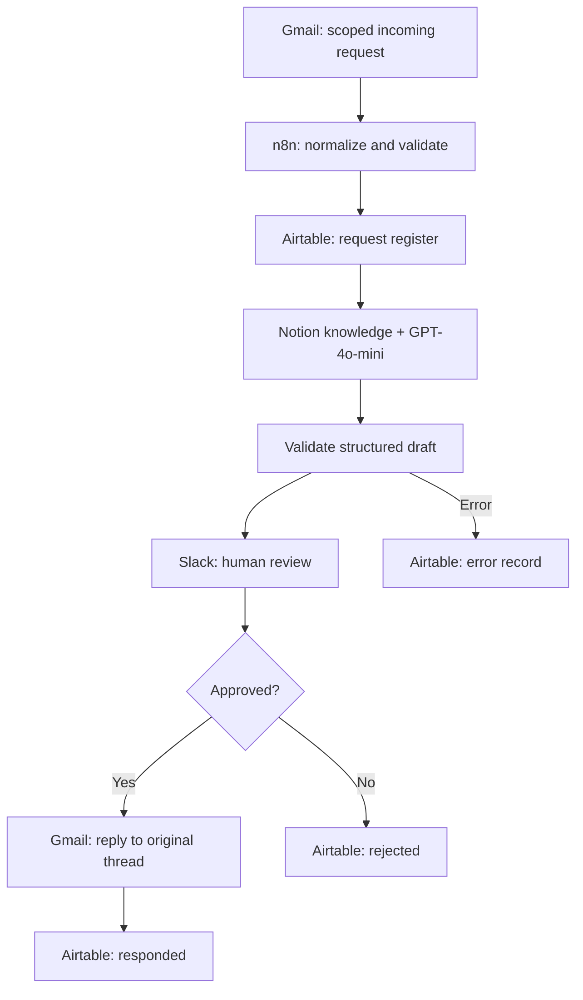

# SmartDesk AI | AI-Powered Administrative Workflow Automation

**An end-to-end automation case study with human approval — n8n · OpenAI · Gmail · Airtable · Notion · Slack**

  

> **Business challenge.** Incoming administrative requests need to be recorded, classified, prioritized and answered consistently. Handling every step manually makes follow-up difficult and increases the risk of missed requests.
>
> **My solution.** I designed and tested an **n8n workflow with 24 nodes** that reads scoped messages, registers requests in Airtable, consults curated information in Notion, uses GPT-4o-mini for classification and a draft, and sends an approval request to Slack. **The human reviewer retains control before sending an external response.**
>
> **Technical evidence.** Sanitized workflow JSON, architecture, test scenarios, operational documentation, and a [recorded demonstration](https://youtu.be/qwjR3EYyDpg).
>
> **Scope.** This is an **academic prototype inspired by real administrative challenges**, not an official UNSJ system nor an autonomous production deployment. The code is published as a portfolio demonstration.

## How I approached the problem

| Step | Business / technical contribution |
|---|---|
| Discover | Identify repetitive email handling and weak traceability |
| Design | Model intake, validation, classification, review and response |
| Integrate | Connect Gmail, Airtable, Notion, GPT-4o-mini and Slack |
| Govern | Introduce JSON validation, error paths and mandatory human approval |
| Validate | Execute controlled tests for approval, rejection, errors and insufficient information |
| Document | Publish technical architecture, sample outputs and operating guidance |

## Architecture at a glance

## What this demonstrates

**AI workflow design · n8n orchestration · API/service integrations · Structured output validation · Human-in-the-loop governance · Error handling · Administrative process analysis · Technical documentation · Testing**

**View the evidence:** [Workflow export](workflows/gestion-solicitudes-idei.sanitizado.json) · [Architecture](docs/arquitectura.md) · [Test cases](docs/pruebas-y-evidencias.md) · [Deployment guide](docs/despliegue.md) · [Demo video](https://youtu.be/qwjR3EYyDpg)

**Related project:** [Sala 13 — room booking and administrative automation](https://github.com/MASilva1/sala13-booking-system).

---

## Caso completo en español

**Automatización con IA, trazabilidad y aprobación humana (HITL)**  
Proyecto académico de automatización administrativa aplicado a un caso de uso del Instituto de Informática (IDEI), FCEFN, Universidad Nacional de San Juan.

**Autor:** Matías Silva · **Versión de referencia:** 7 de noviembre de 2026  
**Estado de la demostración:** flujo n8n activo y validado en el entorno del autor (24 nodos). El archivo público está desactivado por seguridad y requiere configurar integraciones propias.

## El problema

Las solicitudes administrativas llegan por correo, requieren clasificación, priorización, seguimiento y respuestas coherentes. Un proceso exclusivamente manual genera demoras y dificulta la trazabilidad.

## La solución

Una automatización recibe correos etiquetados con [IDEI], normaliza la información, la registra en Airtable, consulta criterios de una base de conocimiento en Notion, propone clasificación y borrador mediante GPT-4o-mini y envía una notificación a Slack para revisión. Solo una aprobación humana permite responder al hilo original de Gmail. El flujo contempla rechazo y registro de fallos.

## Tecnologías y capacidades

| Componente | Función |
| --- | --- |
| **n8n (24 nodos)** | Orquestación, reglas, validación, pausas y rutas de error |
| **Gmail** | Entrada de solicitudes y respuesta al mismo hilo |
| **Airtable** | Registro, relaciones, estado, auditoría y KPI |
| **OpenAI GPT-4o-mini** | Clasificación, resumen y borrador estructurado |
| **Notion** | Consulta de conocimiento validado para orientar respuestas |
| **Slack** | Aviso al responsable para revisión humana (HITL) |

La recuperación de conocimiento se implementa con una herramienta que consulta registros de Notion. **No** se presenta como búsqueda vectorial con embeddings, ya que esa arquitectura no forma parte del flujo publicado.

## Arquitectura resumida

~~~mermaid
flowchart TD
    A[Gmail: correo con IDEI] --> B[Normalizar y registrar en Airtable]
    B --> C[GPT-4o-mini + consulta a Notion]
    C --> D[Validar JSON y reglas]
    D -->|Valido| E[Guardar borrador]
    E --> F[Slack: notificar y esperar HITL]
    F --> G{Aprobacion humana?}
    G -->|Si| H[Gmail: responder al hilo]
    H --> I[Airtable: Respondido]
    G -->|No| J[Airtable: Rechazado]
    D -->|Error| K[Airtable: registrar error]
~~~

## Evidencia de validación — 07/11/2026

Se verificaron cinco ejecuciones reales controladas: **#53 rechazo sin envío**, **#54 aprobación y respuesta**, **#55 error sin respuesta**, **#56 prioridad alta con aprobación** y **#57 consulta incompleta sin inventar requisitos**. En las pruebas #54, #56 y #57 el estado final fue **Respondido**.

El dashboard documentado para esa fecha registra 10 solicitudes, 3 respondidas, 1 error y 3 aprobaciones sobre 5 decisiones humanas. Es una **captura histórica**, no una métrica actualizada en tiempo real.

## Explorar el proyecto

- [Workflow n8n exportado y sanitizado](workflows/gestion-solicitudes-idei.sanitizado.json)
- [Arquitectura técnica](docs/arquitectura.md)
- [Modelo de datos de Airtable](docs/modelo-de-datos.md)
- [Manual operativo](docs/manual-operativo.md)
- [Pruebas y resultados](docs/pruebas-y-evidencias.md)
- [Despliegue y configuración segura](docs/despliegue.md)
- [Seguridad, limitaciones y criterios de IA](docs/seguridad-y-alcance.md)
- [Ejemplo de salida de IA con datos ficticios](examples/salida-ia-ejemplo.json)

### Demostración y documentación externa

- [Video demostrativo en YouTube](https://youtu.be/qwjR3EYyDpg)
- [Documentación completa y evidencias en Notion](https://app.notion.com/p/3f3bc1d8040881b0b4b5fe992db0209e)
- [Airtable: vista de consulta pública](https://airtable.com/appmKVYGezlFiIqUG/shrlgs0EJV8Bf9xiZ)

## ¿Cómo reutilizarlo?

El JSON conserva la estructura de los nodos y conexiones, pero **no contiene credenciales ni identificadores reales** de bases, tablas o canales. Consultá la guía de despliegue, reemplazá los valores REPLACE_WITH_..., conectá tus propias cuentas y probá primero con datos ficticios. No actives el flujo sin verificar los permisos, el manejo de errores y las condiciones de aprobación.

## Alcance responsable

Es un **prototipo académico**: no constituye un sistema oficial de la UNSJ ni reemplaza decisiones administrativas o normas institucionales. La IA propone; una persona decide y autoriza cualquier comunicación externa. No se integró WhatsApp Cloud API en esta versión.

---
*Portfolio de automatización, IA aplicada, integración de sistemas y mejora de procesos. Los ejemplos públicos no contienen solicitudes reales ni datos de terceros.*
